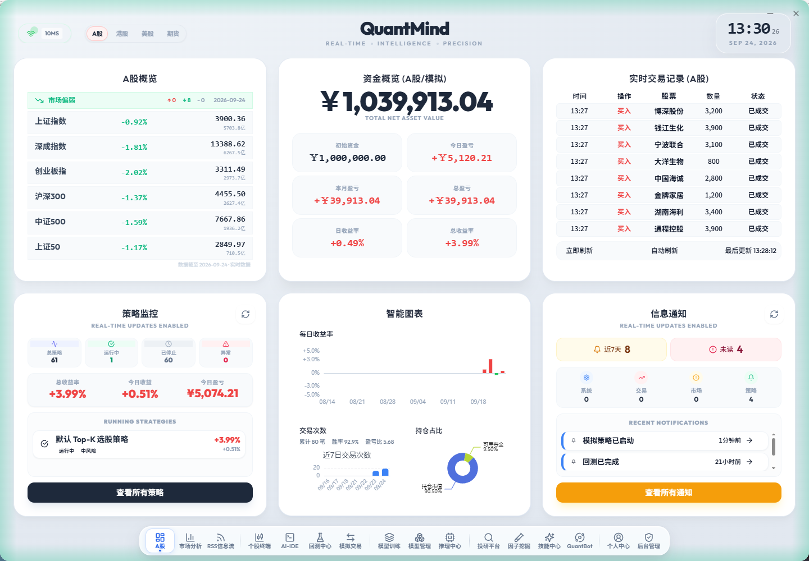
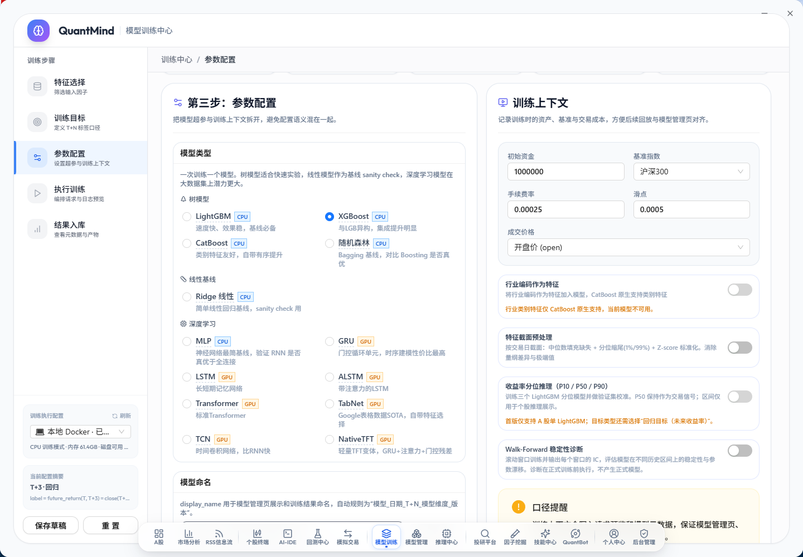
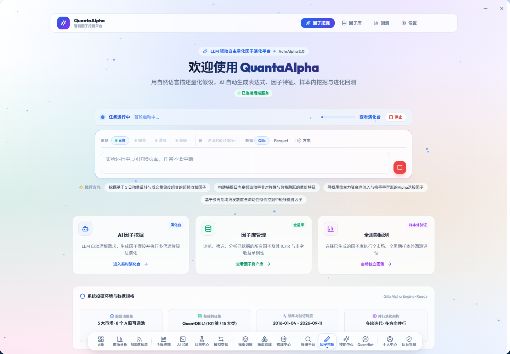
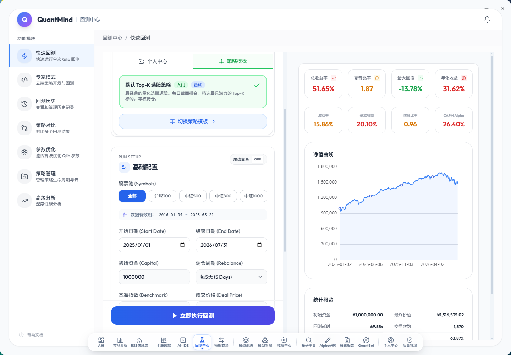
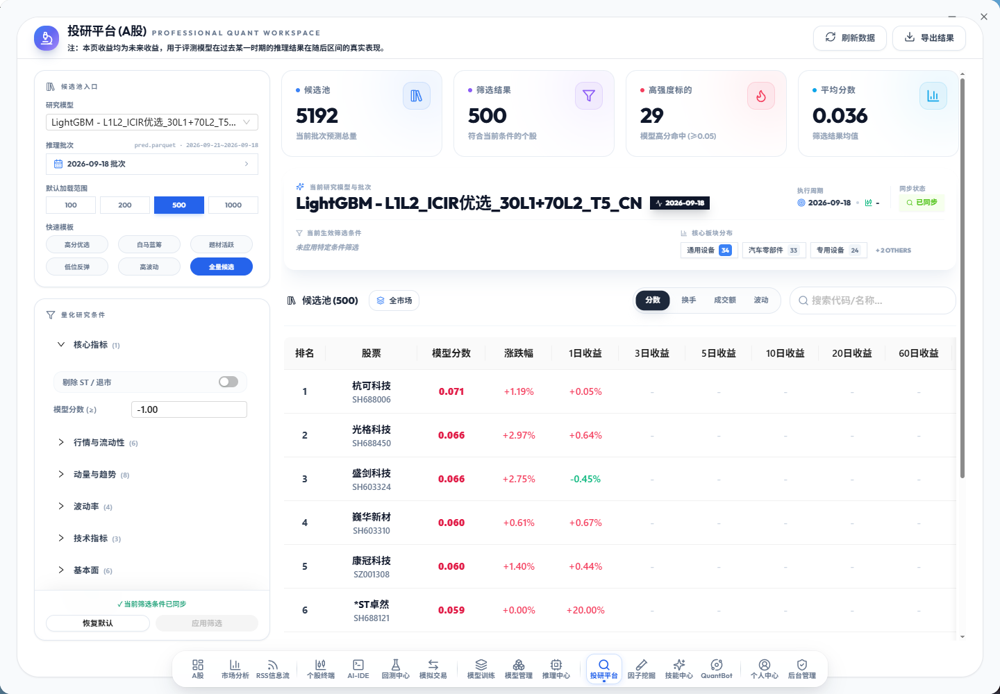
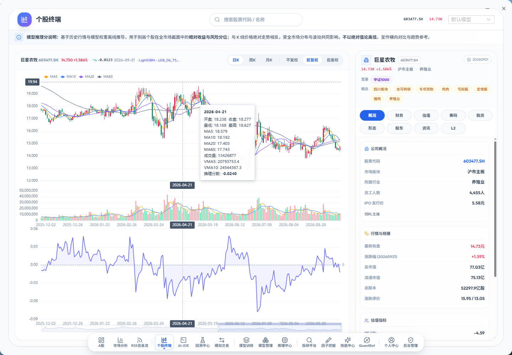

# QuantMind：一款基于模型架构驱动的量化交易系统，已开源

> 一个人维护的量化平台：因子挖掘、模型训练、回测验证、选股、模拟交易，跑在同一个系统里。

大多数量化工具会止步于「给你一个回测引擎」，或者「给你一个数据接口」。真正麻烦的部分在于把这两头接起来——用同一套股票代码口径、同一份因子快照、同一套模型版本，从挖掘一路走到下单，中间不掉链子。

QuantMind 想解决的就是这件事。它是完整的：数据、因子、模型、回测、推理、组合、交易，都在一个仓库、一套数据库、一套前端里。



首页是决策视图：多市场看板（A股 / 港股 / 美股 / 期货）指数概览、账户资金、运行中的策略监控、实时成交记录、每日收益率分布、持仓占比、通知中心。行情通过本地桥接推送，界面左上角实时显示链路时延（图中为 10ms）。

---

## 一、模型架构：13 种可选，不是只有 LightGBM

这是项目名字里「模型架构驱动」的由来。训练中心的模型池按家族分层，每一类都有明确的适用场景说明，而不是堆一堆名字让你猜：

| 家族 | 模型 | 定位 |
|---|---|---|
| 树模型 | LightGBM / XGBoost / CatBoost / 随机森林 | 速度与效果的基线，CatBoost 对类别特征友好 |
| 线性 | Ridge | 基线 sanity check，判断非线性到底贡献了多少 |
| 深度学习 | MLP / GRU / LSTM / ALSTM / Transformer | 时序建模，GRU 是性价比最高的档 |
| 深度学习 | TabNet / TCN / NativeTF | 表格 SOTA、时序卷积、轻量 Transformer 变体 |



除了选模型，训练目标支持 T+N 口径的分类 / 回归 / 排序三种，标签定义写死在配置里而不是散落在脚本中。上下文参数也一并管起来：行业编码是否作为特征、截面缺失值填充与 Z-score 标准化、收益率分位推理（P10/P50/P90，用于「回归模型当作排序信号」的场景）、Walk-forward 稳定性诊断（滚动窗口逐段检验模型在不同历史区间的稳定性，不产生正式模型）。

训练跑在 Celery 队列上，支持本地 Docker（CPU）和远端 GPU 节点（AutoDL / SeetaCloud）两种执行环境，多租户隔离。

---

## 二、因子：让 LLM 自己写因子，然后做样本外验证

传统因子研究是「想到一个假设 → 手动写表达式 → 跑 IC → 大概率证伪 → 重来」。这个循环太慢，所以项目内置了 QuantaAlpha —— 一个 LLM 驱动的因子演化引擎。



流程是：用自然语言描述假设 → AI 生成因子表达式与特征 → 在样本内挖掘与迭代进化 → 进因子库 → 全周期回测 → 样本外验证。界面里会给出当前演化方向（比如「挖掘基于 5 日动量反转与成交量偏度的超额收益因子」），生成的因子不是黑盒，每个都能落到表达式级别去审。

底层数据来自 QuantDB：**8 大数据集、300+ 量化字段**，覆盖 A 股（沪 / 深 / 北）、指数、ETF、可转债与 3 秒 Tick 分笔。

因子侧分三层。Features Daily 是日线宽表，装均线、振荡、量能、股本市值、估值与标的属性；**L1 日频因子 110 维**，按换手率、资金量、动量、波动、技术图形、财务估值、筹码分布、风格、行业截面、概念热度分 10 大类；**L2 高频因子 211 维**，由逐笔成交、10 档盘口和逐笔委托合成，覆盖价差微观结构、已实现波动、资金流、VPIN、订单簿深度、撤单流等 12 组。三层按 `(symbol, date)` 合并成 `l1_l2_factors` 宽表，可以直接喂 LightGBM / XGBoost。

历史起点 2016 年（后复权以 2016 年首个交易日为基准）。工程上做了零前视：估值按公告日对齐、财务按公告日前向填充、L1/L2 因子不带未来信息——训练时唯一要自己动手的是构造标签，`future_return_1d ~ 60d` 得记得从特征矩阵里剔掉。

全系统只认 QuantDB 自建的 Parquet，不混用第三方数据源——这一点在后期对齐因子快照时能救命。

---

## 三、回测：Qlib 引擎，指标给全

回测中心基于 Qlib，但把工程外壳补上了：策略模板选择、股票池、数据有效期、起止日期、初始资金、调仓周期、基准指数、成交价格（开盘 / 收盘 / 均价），跑完直接出全套指标。



这个示例是「默认 Top-K 选股策略」，2025-01 到 2026-07、初始资金 100 万、5 日调仓：

| 指标 | 数值 | 指标 | 数值 |
|---|---|---|---|
| 总收益率 | 51.65% | 年化收益 | 31.62% |
| 夏普比率 | 1.87 | 最大回撤 | -13.78% |
| 信息比率 | 0.96 | CAGR Alpha | 26.40% |
| 年化波动率 | 15.86% | 基准收益 | 20.10% |
| 胜率 | 63.87% | 交易次数 | 1,570 |

回测耗时 69.55 秒，初始资金 100 万最终跑到 151.6 万。除了快速回测，还有专家模式（直接写 Python 策略代码跑）、参数优化（遗传算法调参）、策略对比（多结果同图）、历史记录管理。

专家模式背后是一个带 AI 助手的策略 IDE：左边是策略模板库（十几个可直接运行的 A 股策略），中间是 Monaco 编辑器，右边 AI 可以读你的代码并解释策略逻辑、改参数、跑通校验。

---

## 四、投研：从 5192 只筛到 29 只

模型训练完不等于能选股。投研平台是把「模型分数」变成「可执行的候选池」的地方。



一次完整的批次输出：候选池 5192 只 → 按模型分数与过滤条件筛到 500 只 → 高强度标的 29 只（模型高分命中，p<0.05）。筛选条件分六类：核心指标、行情与流动性、动量与趋势、波动率、技术指标、基本面，每类可展开细调，支持删除 ST / 退市、按行业标签（通用设备 / 汽车零部件 / 专用设备）分组。

列表直接给出 1 日 / 3 日 / 5 日 / 10 日 / 20 日 / 60 日的前瞻收益，用来回看这一批选股在后续时间里的真实表现——不是回测拟合，是「当期推荐 + 后续验证」。

---

## 五、个股：把模型分说落到单只股票上

选出来之后还得看。个股终端把 K 线、技术指标和模型信号叠在一张图上：



上方是日 / 周 / 月 K 加 MA5/10/20/60、成交量、VWAP，下方副图是模型推理分数的时序曲线——能直观看到「分数在什么时候领先于价格」。右侧是公司概况、估值指标、财务、股东、资讯、十档盘口。

顶部有一行模型推理分说，把这个分数的口径写清楚了：基于历史行情与模型权重离线推导，刻画个股在全市场截面中的相对收益与风险分位，与 K 线价格的绝对高低无关，受全市场分布与流动性共同影响，不宜以绝对值论高低，宜横向对比与趋势参考。这类「把模型的边界说清楚」的说明，比多画十个指标有价值。

---

## 六、交易与自动化

研究链路之外，交易侧也在同一个系统里：

- **模拟盘**：完整撮合、持仓核算、资金曲线，策略可跑在「观察态」（只跑链路不下单）与「模拟交易」两种模式下
- **行情通道**：通达信 TQ 本地桥接实时推送，全系统统一后缀式代码口径（如 600036.SH）
- **委托安全**：任何报单先本地落库持久化，再发往外部通道，避免「外部已成交、本地无记录」
- **定时任务**：Celery beat 调度，每日行情同步、模型推理、组合再平衡按交易日历触发
- **风控**：大跌拦截 -10.0%、止损 -8.0%，规则可配
- **多租户隔离**：账户、策略、模型、因子全部按租户隔离

---

## 技术栈

| 层 | 选型 |
|---|---|
| 后端 | Python / FastAPI / Qlib / Celery / DuckDB / asyncpg |
| 存储 | PostgreSQL（行情 · 交易 · 用户）/ Redis（6 库分域）/ 对象存储 + 本地卷（策略 · 报告 · 模型）/ Qlib Parquet（特征 · 日历 · 因子） |
| 前端 | Electron + React + TypeScript + Vite + Tailwind |
| 数据 | QuantDB 自建管线（行情 + 财务 + 300+ 维因子宽表），Parquet 优先，禁止第三方数据源混用 |
| AI | 多模型 provider 抽象 + MCP 服务（42 个工具 / 8 大类）+ 30 个 QuantBot 技能包 |

架构上后端收敛为四个服务：`api`(8000) / `engine`(8001) / `trade`(8002) / `stream`(8003)，共享层 `backend/shared` 统一管理 DB、Redis、配置、策略存储、交易日历、股票代码工具。开源版默认单容器多进程，一条命令起全栈。

全部代码约 50 万行（自有部分，不含引入的上游项目）。

---

## 开源

项目从今年 4 月开源，到现在 GitHub 上 **1.8k star / 407 fork**，主语言 Python，支持 Docker Compose 一键私有化部署。

```bash
git clone https://github.com/qusong0627/QuantMind.git
cd QuantMind
cp .env.example .env
docker-compose up -d
```

- GitHub：https://github.com/qusong0627/QuantMind
- 官网 / 文档：https://oss.quantmindai.cn/
- 开源协议：**AGPL-3.0** —— 可免费商用、可私有化部署，但基于本项目的衍生作品（含以网络服务形式对外提供）需同样以 AGPL-3.0 开源。

---

## 写在最后

这是个单人项目，坑不少：引擎内部有历史包袱，部分模块的单文件已经长到两三千行，测试覆盖也偏薄。但它在真实运行 —— 每天自动拉行情、跑推理、盯模拟盘。

如果你也在折腾量化，欢迎 issue 和 PR，尤其是这几块：因子有效性的统计检验、组合优化的风险模型、回测的滑点建模。

**风险提示**：本项目仅用于技术研究与学习交流，不构成任何投资建议。历史回测收益不代表未来表现，实盘交易有亏损风险，请自行评估。
